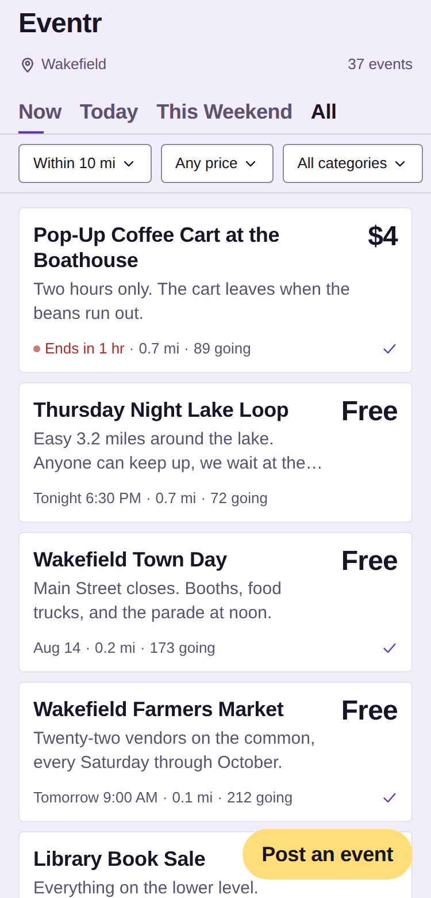
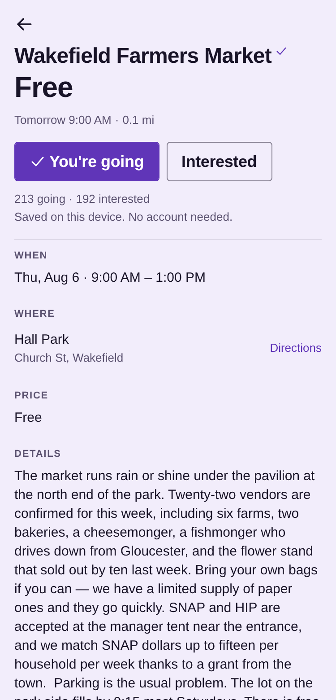
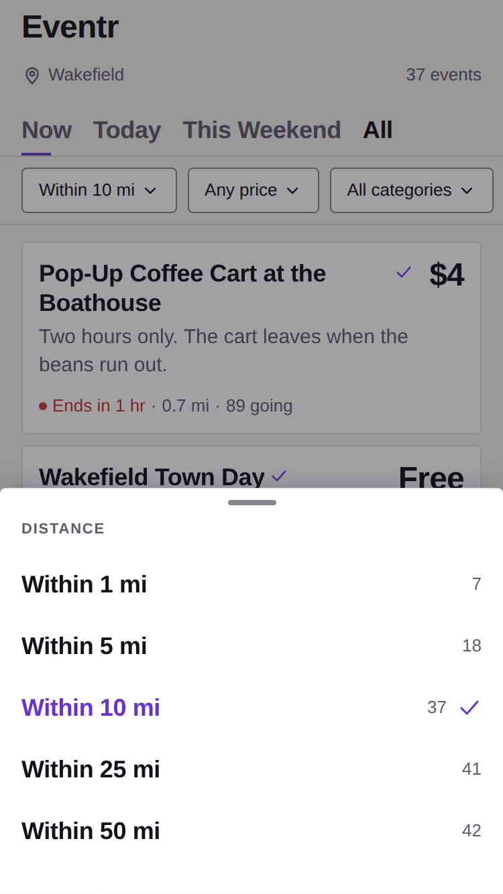
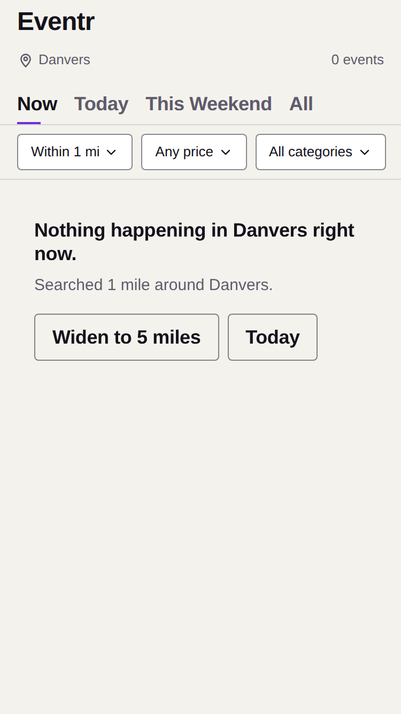

# Eventr

**A community bulletin board for local events. Scroll, sort, show up.**

You get in the car with a friend. "What do you wanna do?" "I'm down for anything." "Me too."
Forty minutes later you're in a parking lot eating the same fast food for the thousandth time.
Meanwhile your town had a farmers market, a free concert, and a 5K, and nobody told you.

Eventr is a radius-scoped feed of everything happening near you — free events first, no account
to browse, no tickets sold, ever.

**Live:** https://seanjoudrie.github.io/eventr/

---

## Contents

- [What it is](#what-it-is)
- [Status](#status)
- [Screenshots](#screenshots)
- [Quick start](#quick-start)
- [Scripts](#scripts)
- [Architecture](#architecture)
- [The feed](#the-feed)
- [Paid placement, and the line it doesn't cross](#paid-placement-and-the-line-it-doesnt-cross)
- [Design system](#design-system)
- [Accessibility](#accessibility)
- [Data model](#data-model)
- [Testing](#testing)
- [CI and deployment](#ci-and-deployment)
- [Configuration](#configuration)
- [What is not built](#what-is-not-built)
- [Conventions](#conventions)
- [Documentation index](#documentation-index)

---

## What it is

A mobile-first web app — one Expo codebase that ships to the web today and to the App Store later
without a rewrite. You open it, it asks one question ("where are you?"), and then it shows you
what is happening nearby, sorted by how close and how soon.

**What it deliberately is not:**

| | |
|---|---|
| Not a ticketing platform | Paid events link out to wherever tickets are actually sold. We never touch money — no checkout, no cart, no fees, and no PCI scope. |
| Not a social network | No profiles, no followers, no likes, no DMs. Going, Interested, and comments are the entire interaction surface. |
| Not account-gated | Browsing and RSVPing require no account. Identity is a device id in local storage. |
| Not pay-to-rank | Money buys one labelled slot above the feed. It buys nothing inside the ranking. See [below](#paid-placement-and-the-line-it-doesnt-cross). |

Launch scope is Greater Boston, seeded from Wakefield and the North Shore. A sparse feed is a dead
app, so depth in one metro beats breadth across fifty.

---

## Status

Working app, no backend. Everything you can see and touch runs; roughly half the system behind it
has been written and never executed.

| Area | State |
|---|---|
| Feed, filters, sorting, ranking | **Built and tested.** Real logic, not a mock. |
| Event detail, transitions, deep links, `.ics` export | **Built.** |
| Going / Interested | **Built.** Device-scoped, persisted, survives reload. |
| Posting | **Built.** Local only — posts live on the device that made them. |
| Review queue (`/moderate`) | **Built, unlisted, not access-controlled.** It reviews your own device's posts. |
| Ads and boosted slots | **Built as a surface.** House ads only. Nothing is charged. |
| Supabase schema, RLS, ranking SQL, archive job | **Written. Never run.** No project exists yet. |
| Comments | Schema only, no UI |
| Photos, offline mode, payments, native builds | Not started |

The honest inventory — what can be reviewed today, what can't, and what it would cost to close
each gap — is [`docs/REVIEW-READINESS.md`](docs/REVIEW-READINESS.md). Read it before trusting any
claim in this file.

---

## Screenshots

| | |
|---|---|
|  |  |
| The feed at 375×667 — four cards on a phone screen, price loud, live dot on anything in progress | Event detail, reached by a transition that starts at the card's measured position |
|  |  |
| The radius sheet, showing a live match count for every option before you pick one | An empty result that names the constraint and offers the fix |

More in [`docs/screenshots/`](docs/screenshots/) — every state, every candidate palette, and a
frame of the card-to-detail transition caught 110ms in.

---

## Quick start

Requires **Node 22+**. Nothing else — no database, no API keys, no Docker.

```bash
git clone https://github.com/SeanJoudrie/eventr.git
cd eventr
npm ci
npm run web          # opens the app in a browser
```

The app runs end to end against bundled seed data: 42 events across 22 real Greater Boston towns,
posted by plausible organizations, scheduled relative to the moment you load it so the "Now" tab
always has something in it.

Other targets:

```bash
npm start            # Expo dev server — scan the QR code for iOS/Android
npm run ios          # iOS simulator (requires a Mac; never verified — see REVIEW-READINESS)
npm run android      # Android emulator
```

Before committing:

```bash
npm run verify       # typecheck + lint + format + contrast audit + 62 unit tests
```

`npm run prepare` (which `npm ci` runs for you) points `core.hooksPath` at `.githooks/`, so
typecheck, lint, and format also run as a pre-commit hook.

---

## Scripts

| Command | What it does |
|---|---|
| `npm start` | Expo dev server, all platforms |
| `npm run web` | Dev server, web only |
| `npm run ios` / `npm run android` | Native simulators |
| `npm run typecheck` | `tsc --noEmit` under strict + `noUncheckedIndexedAccess` |
| `npm run lint` | ESLint, zero warnings tolerated |
| `npm run format` / `format:check` | Prettier |
| `npm run audit:contrast` | Computes every text/surface pairing in all 6 palettes against WCAG AA and exits non-zero below threshold |
| `npm run test:feed` | 39 tests over radius, windows, filters, sorting, ranking, capacity, town ranking, ad placement |
| `npm run test:format` | 23 tests over the strings a user reads on every card — time, distance, price, `.ics` output |
| `npm run verify` | All of the above. The CI gate and the pre-commit hook. |
| `npm run test:e2e` | 21 Playwright tests against the Metro dev server |
| `npm run test:e2e:export` | The same 21 against the static export, served the way Pages serves it |
| `npm run build:web` | `expo export` plus the two files Pages needs (`.nojekyll`, `404.html`) |
| `npm run serve:export` | Serves `dist/` with the `/eventr` base path and `.html` resolution, like production |

The test runners are plain Node — `scripts/ts-resolver.mjs` teaches Node the `@/` alias and
extensionless imports so there is no test framework and no build step.

---

## Architecture

### Stack

| Layer | Choice | Why |
|---|---|---|
| App | Expo SDK 57 · React 19.2 · React Native 0.86 · TypeScript 6 (strict) | One codebase, web now and iOS later. Not a wrapper — real native. |
| Navigation | Expo Router (typed routes) | Real URLs on web, real native stacks on device |
| Data fetching | TanStack Query | Cache and refetch for a read-heavy feed, without Redux ceremony |
| Animation | Reanimated 4 + gesture-handler | Runs on the UI thread; every transition is interruptible |
| Backend (planned) | Supabase — Postgres + PostGIS + Storage | Radius queries and photo hosting solved by the database. No server to run. |
| Components | **None.** Hand-built. | A recognizable component-library default look is the tell this project exists to avoid. |

### Repo layout

```
app/                        Expo Router — routes only, no business logic
  _layout.tsx               providers: query client, theme, preferences, my-events, rsvp
  index.tsx                 the feed (redirects to /location on first run)
  event/[id].tsx            detail; emits one static HTML page per event at build time
  post.tsx                  the post form
  location.tsx              the first-run location gate
  moderate.tsx              the review queue (unlisted)
  gallery.tsx               every primitive in every state (__DEV__ only)
  palettes.tsx              the real feed under each candidate palette (__DEV__ only)

src/
  design/
    tokens.ts               color, type, space, radius, elevation — single source
    motion.ts               durations, easings, springs, haptics, reduced-motion
    palettes.ts             the six studied candidates
    theme.tsx               useTheme()
    primitives/             15 hand-built components
  features/
    feed/                   FeedScreen, EventCard, AdCard, TimeTabs, FilterSheets,
                            feedItems (ad + promoted placement), scrollMemory
    event/                  EventDetail, BoostSheet, heroStore (transition geometry)
    rsvp/                   RsvpButtons
    post/                   PostForm
  data/
    source.ts               the DataSource contract
    local.ts                LocalSource — the real filtering and ranking, over seed data
    index.ts                backend selection, the only file that knows which source is live
    ranking.ts              the score function, mirrored in SQL
    static.ts               synchronous build-time reads for static rendering
    ads.ts                  ad inventory
    seed/events.ts          42 events, 22 posters
  lib/                      time, geo, towns, capacity, calendar, links, seo, env,
                            preferences, rsvp, myEvents, queries/
  copy/strings.ts           every user-facing string, in one file
  types/event.ts            domain types, mirroring the SQL schema

supabase/migrations/        0001 schema + RLS · 0002 view, ranking, radius query, archive job
scripts/                    contrast audit, feed tests, format tests, export server, resolvers
e2e/                        21 Playwright specs
docs/                       phase gate reports, color study, review readiness, screenshots
```

**Three rules hold this together, and two of them are lint-enforced:**

1. Routes contain no business logic. They wire a feature component to the router.
2. Primitives never import from `features/`.
3. Nothing outside `src/design/` defines a color, duration, or spacing value. A hex literal outside
   `src/design/` is an ESLint error, and so is importing the raw `palette` instead of `useTheme()`.

### Data flow

```
        components / screens
                 │
                 ▼
        lib/queries/*  (TanStack Query hooks)
                 │
                 ▼
        getDataSource()            ← src/data/index.ts, the only switch
                 │
        ┌────────┴────────┐
        ▼                 ▼
   LocalSource       SupabaseSource
   (shipping)        (lands when a project exists)
```

No component calls a data source directly. `LocalSource` is **not a mock** — the radius filtering,
window semantics, price and category filters, sorting, and ranking are the real implementations,
tested and pinned. When Supabase arrives, `src/data/index.ts` changes and nothing above it does.

The contract is three methods:

```ts
interface DataSource {
  readonly kind: 'local' | 'supabase';
  listEvents(filters: FeedFilters): Promise<FeedPage>;
  getEvent(id: string, origin: Coordinates): Promise<FeedEvent | null>;
  countEvents(filters: FeedFilters): Promise<number>;   // counts without paying for rows
}
```

`countEvents` exists for one feature: the radius sheet shows a live match count next to every
option, so you can see the shape of your neighbourhood before committing to a radius.

### Routes

| Route | Screen | Notes |
|---|---|---|
| `/` | Feed | Redirects to `/location` until a town is chosen |
| `/location` | Location gate | Town search ranked by proximity and event density; GPS optional |
| `/event/[id]` | Detail | `generateStaticParams` emits one real HTML page per event |
| `/post` | Post form | No account; the post lands in `pending` |
| `/moderate` | Review queue | Unlisted. Not access control — see the note in the file. |
| `/gallery` | Primitive gallery | `__DEV__` only; renders "Not found" in production |
| `/palettes` | Palette comparison | `__DEV__` only |

---

## The feed

The feed is the whole product. Everything else is in service of it.

### Filtering

| Control | Options |
|---|---|
| **Radius** | 1 / 5 / 10 / 25 / 50 mile presets, plus a continuous slider from 1–50 |
| **Window** | Now · Today · This Weekend · All |
| **Price** | Any · Free only · Under $10 · Under $25 |
| **Category** | Twelve categories, multi-select |
| **Sort** | Ranked · Nearest · Soonest |

Radius, price, and category persist to device storage. The time tab deliberately does not —
reopening the app tomorrow still showing yesterday's "Now" would be wrong.

Filters compose, and that composition is a test:

| Filters | Results |
|---|---|
| Wakefield, 10 mi, all | 37 |
| → 5 mi | 18 |
| → + Free only | 14 |
| → + Running | 2 |

### Ranking

Transparent and explainable, never a black box. Three bounded terms, and no paid term at all:

```
score = proximity + imminence + traction

  proximity   0.35 weight, falloff exponent 1.5
              closer is better, falling off sharply toward the radius edge rather
              than linearly

  imminence   0.35 weight
              starting soon beats starting in three weeks; anything live right now
              scores as if it were starting this second

  traction    0.20 weight, log-dampened, saturating at 100
              so a 900-person festival cannot bury a 12-person run club
```

The `Now` tab drops traction entirely — it is pure "what is happening right this minute nearby."

This function exists twice: `src/data/ranking.ts` and `event_score()` in
`supabase/migrations/0002_feed.sql`. Both files say so at the top, and `npm run test:feed` pins the
TypeScript behavior, so a divergence surfaces as a failing test rather than as a feed that ranks
differently depending on which backend is live. The duplication disappears when SQL becomes the
only implementation in production.

### Capacity

"Filling up" is derived, never hand-set, and only from two numbers that actually exist — a stated
capacity and a going count. `filling` at 70%, `full` at 95%. Most events have no meaningful limit
(a farmers market does not fill up), so `capacity` is null far more often than not and most cards
carry no badge at all. A badge on everything is decoration; a badge on one card in forty is
information.

The `over` state is worded carefully: a going count is a show of hands, not a ticket sale. Forty
people tapping Going at a room that seats thirty means more people are planning to come than fit —
not that you'd be turned away at the door.

---

## Paid placement, and the line it doesn't cross

This is the part of the product most likely to drift, so it is the part written down hardest.

**Money buys a labelled slot. It never buys a better organic position.**

An earlier version added a hidden `0.15` boost to a boosted event's score. That is undisclosed paid
placement — a reader cannot tell a bought result from an earned one, which is both what makes feeds
feel rigged and what disclosure rules exist to prevent. It is gone. `src/data/ranking.ts` has no
paid term, and `npm run test:feed` asserts that a closer, sooner, unboosted event outranks a
farther, later, boosted one.

What a boost buys instead: **one** slot at the top of the feed, above the ranked list, visually
separated and labelled. The advertiser gets the top of the screen, which is what they are paying
for. The ranking stays honest, which is what readers are paying attention for.

Three card types, distinguishable without reading:

| Type | Edge | What it is |
|---|---|---|
| Organic event | hairline | A normal listing. The default. |
| Promoted event | gold | A real local event whose organizer paid for reach |
| Paid ad | blue | An advertiser with no event |

Every non-organic card carries a plain-text label. The coloured edge is reinforcement for people
who can see it — a colour alone cannot tell a colourblind reader that money changed hands, and a
gold that clears 3:1 on white is no longer gold.

**Density is one ad per eight organic cards** (`AD_INTERVAL` in `src/features/feed/feedItems.ts`),
roughly two to three screens apart on a phone. That number is a judgement, not a finding, so it is
written down where a test can hold a line on it. Instagram and its imitators run closer to one in
four; that density is what makes them feel like a mall.

Ads cycle in a fixed order rather than shuffling, so scrolling back up shows the same ad in the
same place. Current inventory is one house ad. Nothing is charged, and `BoostSheet` records what a
poster asked for rather than miming a checkout that does nothing.

---

## Design system

The hard requirement, from [`DESIGN.md`](DESIGN.md): **this must not read as generated.** That is
a checklist, not a vibe.

### Tokens

Everything lives in `src/design/tokens.ts`. One scheme — light. A dark ramp existed through Phase 4
and was removed, because the dark purple surface read as a generated default rather than a
decision.

```
ink         #191428   near-black, purple-leaning. body text, borders, most type
paper       #FFFFFF   card and sheet backgrounds
lilac       #F2EDFB   page background — the pastel field
lilac-deep  #E6DCF6   sunken surfaces, skeletons
grape       #6035B8   brand. active chips, the wordmark, the Going fill
grape-deep  #42217F   pressed states
sun         #FFDE7A   accent only. Interested, capacity badges
slate       #5B5270   secondary text. the only grey
flag        #B02D26   destructive, cancelled, report
gold/tide   #C99400 / #1D5FBF   the two paid-placement edges
```

**The pastel is the page; cards stay white.** A pastel cannot carry body text and cannot be text on
white, so a tinted field behind white cards is its only honest job — and it keeps every description
on plain white, where long text is easiest to read.

The shipping palette is **Lilac**, chosen from six candidates in
[`docs/COLOR-STUDY.md`](docs/COLOR-STUDY.md). That study renders each candidate behind the real
feed rather than on a swatch grid, because a palette on a swatch grid tells you nothing. It also
opens by throwing out most of the colour-psychology literature as folklore, including the parts
that would have supported its own conclusion.

Type sizes jump decisively — 32 / 24 / 18 / 15 / 13 / 11 — because even 2px increments read as
generated. Radius is 4px everywhere except the post button. Borders instead of shadows; elevation
only where something genuinely floats.

### Primitives

Fifteen hand-built components in `src/design/primitives/`: `Text`, `Icon`, `Press`, `Button`,
`Chip`, `Card`, `Badge`, `Verified`, `Skeleton`, `States` (empty/error/end-of-list), `Sheet`,
`Toast`, `Divider`, `Slider`, `Odometer`.

Two worth calling out:

- **`Odometer`** — the count roll on Going. Each place is a column of 0–9 that translates to its
  target, so "only the changed digits move" falls out of the structure instead of being computed.
  No state, no effects. The columns are hidden from assistive tech three different ways
  (`accessibilityElementsHidden`, `importantForAccessibility`, `aria-hidden` — iOS, Android, and
  web each honour a different one) while the strip carries the real value as its label.
- **`Verified`** — a corner mark that answers for itself. Tapping it opens one sentence naming the
  organizer and what was actually checked. A check mark nobody can interrogate certifies nothing.
  It is absolutely positioned so it lands at one constant x on every card; inline, its position
  moved with the title's length and a column of cards read as misaligned.

`/gallery` renders every primitive in every state on one screen, `__DEV__` only.

### Motion

`src/design/motion.ts` is the only place a duration, easing, or haptic may be defined. The rule
governing all of it: **animation is feedback, never decoration.**

```
instant   0ms     optimistic state changes — never wait on a network call
tap       90ms    press-in / press-out
snap      140ms   toggles, chips, the tab underline, count rolls
move      220ms   sheets, shared-element transitions, page pushes
settle    320ms   dismissals and undo — deliberately slower than commit
slow      900ms   ambient only, and only the live dot
```

`prefers-reduced-motion` is resolved inside the motion module rather than at each call site, so it
was honoured by the first animation rather than retrofitted after the last one.

The card-to-detail transition does not use Reanimated's `sharedTransitionTag`, which is native-only
— shipping it would have meant a transition that silently does nothing on the one platform this app
actually launches on. Instead the card measures itself on press and hands the rect to the detail
screen; the header starts at that rect and springs into place while the body crossfades behind it.
Every value is one we control, which is what makes it interruptible in both directions.

### The anti-tells

`DESIGN.md` Part 1 lists what actually gives an AI-built app away, and the codebase is built
against that list: zero emoji, zero gradients, no component-library defaults, flat hard-edged
bordered cards at 4px, density over airiness (3+ cards on a 375×667 screen), no marketing voice, no
exclamation points, and seed data that names real places at awkward real times like 6:45.

Every user-facing string lives in `src/copy/strings.ts` so the voice audit is a single file review
rather than a codebase grep.

---

## Accessibility

Treated as a build gate, not a pass at the end.

- **Contrast.** `npm run audit:contrast` computes every text/surface pairing across all six
  palettes and fails the build below WCAG AA. It runs inside `npm run verify`, so a token change
  that breaks contrast cannot ship. Decorative pairings are marked exempt with the WCAG clause that
  exempts them, not silently skipped.
- **Tap targets.** 44×44 minimum, tokenized as `size.minTapTarget`.
- **375px.** The design is held to it, and Playwright runs at exactly 375×667.
- **Screen readers.** Every interactive element carries a label; RSVP buttons report `checked`;
  counts announce their value rather than their digits.
- **Reduced motion.** Verified — the count roll and the fill sweep both resolve instantly.

Two things are **not** verified, and the project says so rather than claiming otherwise: 200% text
size (react-native-web renders in px, so browser zoom does not exercise Dynamic Type) and anything
requiring a real device.

---

## Data model

Two migrations in `supabase/migrations/`, written per [`BLUEPRINT.md`](BLUEPRINT.md) §2. **Neither
has been applied to a project.**

**`0001_init.sql`** — tables, enums, constraints, indexes, and RLS in the same file as the tables
it protects:

| Table | Purpose |
|---|---|
| `devices` | Anonymous device identity. No email, no name, no tracking. |
| `posters` | A contact method we can reach, not an account. Trust attaches here. |
| `events` | The listing. PostGIS `geography(point, 4326)`, GiST-indexed, plus a partial index over `live` rows. |
| `rsvps` | One stance per device per event, switchable |
| `comments` | Flat, author-pinnable, lockable |
| `reports` | One report per device per target, so a single angry person cannot auto-hide an event |

Constraints carry their reasoning: a verified badge must have an expiry, because one without would
outlive the subscription that paid for it.

**`0002_feed.sql`** — the `public_events` view (exposes a poster's display name and badge while
keeping their email and phone unreadable, and folds in RSVP counts), `event_score()`,
`events_within_radius()`, and an archive job moving events out of the feed two hours after they
end. Archived, not deleted: the archive is what proves attendance to a town rec department.

### RLS

The anon key ships in the client bundle, so **RLS is the only thing protecting this data.** The
posture: anonymous clients can read `live` events and `visible` comments, insert their own
rsvp/comment/report, and nothing else. `pending`, `hidden`, and `archived` rows are invisible.
`posters` has no anonymous policy at all — reading it wholesale would expose every organizer's
email and phone. Moderation and anything touching trust is service-role only.

**This has never run.** It is the single largest untested surface in the project. A reviewer can
read the policies and reason about them; nobody has yet tried to read a `pending` row with an anon
key and watched it fail, which is the only thing that actually proves them.

---

## Testing

### Unit — 62 tests, no framework

```bash
npm run test:feed      # 39 — radius, windows, filters, sort, ranking, capacity,
                       #      town ranking, ad and promoted-slot placement
npm run test:format    # 23 — time, distance, price, town search, .ics output
```

Both run against a fixed `now`, so they are deterministic despite seed data being scheduled
relative to the current time.

### End-to-end — 21 Playwright specs, two targets

```bash
npm run test:e2e           # Metro dev server — fast feedback while working
npm run test:e2e:export    # the static export, served the way Pages serves it
```

Those are two genuinely different code paths. The export renders every route at build time and then
hydrates, and it has broken on its own while the dev server stayed fine — an empty `<title>` shipped
for days because nothing ever loaded a built page and looked at it. `scripts/serve-export.mjs`
reproduces Pages' behaviour (the `/eventr` base path, `.html` resolution, `404.html` for unmatched
paths). Both targets run in CI.

The suite covers first run, feed density, the Now tab, the empty state's exact wording, filters
composing and surviving a town change, Going/Interested including rapid taps and persistence,
posting with tags, date validation, scroll restoration, deep links, and page metadata.

Two tests encode mistakes that already happened once: the empty state asserts *"Searched 1 mile"*
singular, and the scroll-restoration test only taps cards already on screen, because tapping an
off-screen one makes Playwright scroll the feed and then blame the app.

---

## CI and deployment

**`.github/workflows/ci.yml`** runs on every push and pull request:

1. `verify` — typecheck, lint, format, contrast audit, 62 unit tests
2. `e2e` — the Playwright suite as a matrix across both targets
3. `build` — a production web build, asserting the export produced per-event pages with real
   titles plus the two files Pages needs

The pre-commit hook runs a subset, but a hook only protects `main` until someone passes
`--no-verify`. CI is the check that actually holds.

**`.github/workflows/deploy-pages.yml`** publishes to the `gh-pages` branch on every push to
`main`. It does not use `actions/deploy-pages`: this repository's Pages source is a branch, and
GitHub pins the `github-pages` environment to that branch alone, so every deploy from `main` was
rejected before the job could start — with no steps and no logs, which reads as an outage rather
than a settings mismatch. Pushing the build output to the branch Pages already serves sidesteps the
environment entirely. Switching the repository's Pages source to "GitHub Actions" would allow the
standard artifact flow instead; that is a settings change, not a code one.

The publish is a single forced commit rather than appended history — bundle filenames carry a
content hash, so every build would otherwise add a full copy of the app and the branch would grow
without bound.

All three jobs build via `npm run build:web`, so what is published is what was tested.

---

## Configuration

Copy `.env.example` to `.env.local`:

```bash
EXPO_PUBLIC_SUPABASE_URL=
EXPO_PUBLIC_SUPABASE_ANON_KEY=
```

Both are safe to expose in a client bundle — RLS is what protects the data. **Never put a
service-role key here.**

Leaving them empty is the supported path today: the app falls back to seed data and runs end to end
with nothing but a checkout. Setting them currently logs a warning and still reads from seed data,
because `SupabaseSource` does not exist yet — a half-wired client that failed in a way that looked
like a network bug would be worse than saying so.

Env reads must stay statically analyzable. Expo inlines `EXPO_PUBLIC_*` at build time by scanning
for literal member access, so `process.env[name]` would compile to `undefined` in a production
bundle while appearing to work in dev. `src/lib/env.ts` is the only place that reads them.

---

## What is not built

Stated plainly, because a README that implies otherwise wastes a reviewer's afternoon.

| | |
|---|---|
| **The backend** | No Supabase project. RLS, the ranking SQL, the archive job, and the trust model have never executed. |
| **Comments** | Schema exists, no UI |
| **Real moderation** | `/moderate` reviews your own device's posts. It is unlisted, not access-controlled, and the banner at the top says so. |
| **Photos** | No upload, no storage. Every card is the text-forward variant. |
| **Offline** | No cached-feed staleness bar, no queued RSVPs |
| **Payments** | Stripe, deliberately last, and only ever for verification and boosts |
| **Device verification** | 60fps, haptics, Dynamic Type, the native swipe-back, and the iOS simulator all need a Mac and a phone |
| **Pull-to-refresh on web/Android** | **Known broken.** It depends on overscroll bounce, which only iOS has. There is currently no way to force a refresh on those platforms. |
| **Legal** | No Terms, no privacy policy. Blocking for real users, not for review. |

Also unbuilt by design: push notifications, accounts with passwords, campus feeds, following,
likes, DMs, in-app ticket payments, algorithmic personalization, and anything GDPR.

---

## Conventions

- **TypeScript strict**, plus `noUncheckedIndexedAccess`, `noUnusedLocals`, and
  `noUnusedParameters`. No `any`.
- **Data access only through TanStack Query hooks in `src/lib/queries/`.** No component calls a
  data source directly.
- **All copy in `src/copy/strings.ts`.** No exclamation points, no adjectives about ourselves, no
  emoji. Name the place and the number: *"Nothing within 5 miles today"*, not *"No events found"*.
- **Naming:** components `PascalCase`, hooks `useThing`, query hooks `useEventsQuery`. Files match
  their default export.
- **Commits:** imperative, scoped, one concern each. The history reads as a changelog —
  *"Order the town picker by proximity and event density"*, *"Make the tab underline move, and make
  Filling up mean something"*.
- **Comments explain why, not what.** Most files open with a paragraph on the decision behind them,
  including the ones that record a rejected first attempt.

The non-negotiables in [`BUILD-PLAN.md`](BUILD-PLAN.md) §1 override convenience, velocity, and any
suggestion to the contrary. Never process a payment for an event. Posting is always free. No
account required to browse or RSVP. No social graph. RLS in the same migration as the table.

---

## Documentation index

| Doc | Answers |
|---|---|
| [`BUILD-PLAN.md`](BUILD-PLAN.md) | **Start here.** Order of operations, phase gates, definition of done, the non-negotiables |
| [`PRODUCT.md`](PRODUCT.md) | What it is, who it's for, how it makes money, compliance posture |
| [`BLUEPRINT.md`](BLUEPRINT.md) | Stack, data model, screens, ranking, build phases |
| [`DESIGN.md`](DESIGN.md) | Tokens, and the specific tells that make apps look generated |
| [`INTERACTIONS.md`](INTERACTIONS.md) | Motion, micro-interactions, the haptics map, consumer details |
| [`COMPETITORS.md`](COMPETITORS.md) | Landscape and positioning |
| [`OPEN-QUESTIONS.md`](OPEN-QUESTIONS.md) | Decided, still open, and assumed |
| [`NEXT-PROMPT.md`](NEXT-PROMPT.md) | The next three workstreams, and the promoted-slot conflict |
| [`docs/REVIEW-READINESS.md`](docs/REVIEW-READINESS.md) | What can be reviewed today, what can't, and what it would cost |
| [`docs/COLOR-STUDY.md`](docs/COLOR-STUDY.md) | Six palettes, measured, rendered behind the real feed |
| [`docs/PHASE-0.md`](docs/PHASE-0.md) … [`PHASE-5-6.md`](docs/PHASE-5-6.md) | Gate reports — what shipped each phase, what was deferred, and what was gotten wrong |

Reading order for someone picking this up cold: `PRODUCT` → `BUILD-PLAN` → `BLUEPRINT` → `DESIGN` →
`INTERACTIONS`, then `docs/REVIEW-READINESS.md` for the current state.
